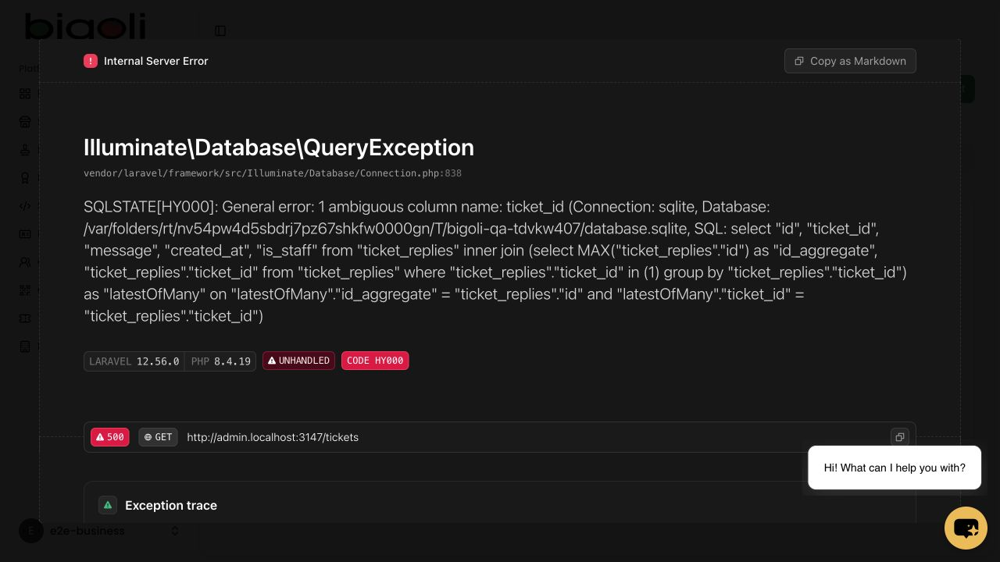

# Bigoli — local UAT and QC execution

Executed on 17 October 2026 (Asia/Manila). **Not ready for unconditional approval:** support tickets have three confirmed defects; eight script cases remain partially tested and blocked.

| Suite | Cases | Pass | Fail | Blocked |
|---|---:|---:|---:|---:|
| UAT | 20 | 14 | 1 | 5 |
| QC | 39 | 36 | 0 | 3 |

Script-case counts differ from automated test counts: multiple assertions/tests support a case, and all three ticket failures relate to UAT-019. Pass means the stated local technical validation passed; it is not business stakeholder acceptance or a guarantee about deployment. Partial camera/email/device cases are Blocked even where their backend portions passed.

## Automated verification

- Existing Laravel suite: **91 passed, 481 assertions**. Evidence: [JUnit](phpunit.xml), [log](phpunit.log).
- Additional checks linked to this test pack: **26 passed, 3 failed, 178 assertions**. Evidence: [JUnit](extended.xml), [log](extended.log), [reproducible tests](ExecutionTest.php).
- Combined: **117 passed / 120 checks, 659 assertions**. The three failures are reproducible support-ticket defects below.
- TypeScript: passed, [log](types.log). Production build: passed, [log](build.log); Vite warned about chunks over 500 kB. Build success does not prove every routed frontend component exists.

## Confirmed defects

1. **DEF-001 — High — Ticket list crashes once a ticket exists.** Create ticket, then reload /tickets. Received HTTP 500 with ambiguous column name ticket_id. The latestReply eager-load projection is unqualified across the latestOfMany join. Source: [TicketService.php](/Users/nathanielalvarez/Herd/bigoli/app/Services/TicketService.php:17). Browser and local HTTP test reproduced this.
2. **DEF-002 — High — Ticket detail cannot render.** Request /tickets/{id} for an owned ticket after build. Controller renders Business/Ticket/Show, but resources/js/pages/Business/Ticket/Show.tsx is absent. Received HTTP 500 with missing Vite manifest entry. Source: [TicketController.php](/Users/nathanielalvarez/Herd/bigoli/app/Http/Controllers/Business/TicketController.php:32).
3. **DEF-003 — Medium — Ticket reply author is missing.** Reply POST persisted its text, but the service returned user.name = null instead of the account identity. It selects/maps name while this project's users store username. This is a reproduced local data defect; behavior on MySQL is not verified. Source: [TicketService.php](/Users/nathanielalvarez/Herd/bigoli/app/Services/TicketService.php:51).

No application fixes were applied during this testing request. All three issues remain Open in the workbook.

## Browser verification

Used separate local hostnames for Admin, Customer and Staff with a newly created disposable SQLite database. No normal application records were modified.

- Admin/customer wrong passwords rejected; correct test credentials reached dashboards; inactive staff denied.
- Branch created and edited; updated address persisted: [evidence](branch-updated.png).
- Staff generated a code; refreshing did not duplicate it; customer manually redeemed it and rated the stamp.
- Customer unlocked reward; staff redeemed it; admin undid redemption: [redeemed](reward-redeemed.png), [undo](reward-undo.png).
- Customer completed seeded 3-stamp card, saw Cycle #1 in History, then started new cycle with one stamp: [completion](completed-card.png), [new cycle](new-cycle.png). Automated cycle tests separately used the workbook's 5-stamp card, minimum 100 and milestones 3/5.
- QR settings persisted and downloaded one-page PDF contained the changed heading/subheading. Physical scan was not exercised.
- Admin customer detail rendered matching account and stamps; populated phone/DOB verified by automated fixture.
- Browser export search QA-BROWSER-002 downloaded exactly one matching row with code AVVV5H8G and correct customer. [Independent export verification](export-verification.json).

## Blocked portions and test tooling

- **ENV-01:** No physical camera/printed QR/device scan was performed. UAT-005, UAT-008 and UAT-010 remain Blocked despite passing settings/PDF and signed-payload backend checks.
- **ENV-02:** Mail was array/faked in isolated tests. Registration/login and token reset passed, but real verification/reset email delivery and opening email links were not tested. UAT-006 and UAT-007 remain Blocked.
- **ENV-03:** Actual concurrent MySQL requests could not run. The existing concurrency script fails at bootstrap due to unresolved Kernel class. A separate test-only copy with fully qualified bootstrap reached the local MySQL server, but its configured account was denied access. No application database was altered. QC-028 and QC-029 remain Blocked. Sequential/stale-model duplicate protection passed; this is not proof of true MySQL concurrency.
- **ENV-04:** Actual mobile devices, agreed browser matrix and camera flow were unavailable. QC-039 remains Blocked; desktop Chromium flows were exercised.
- The old e2e/run.mjs still uses removed /business/dashboard, /customer/login and /staff/login paths. It was inspected but not run; current clean routes were tested directly through the browser.
- Development domains were initially unavailable from this environment; the user explicitly directed local-only testing. Deployed environment behavior is unverified.

## Case-by-case results

| Case | Result | Local outcome / limitation |
|---|---|---|
| UAT-001 | Pass | Browser: invalid credentials rejected; verified owner signed in and reached own dashboard. |
| UAT-002 | Pass | Browser: QA Branch A2 created, address edited and persisted after reload. Automated HTTP create/update also passed. |
| UAT-003 | Pass | Local automated HTTP tests: staff created on own branch and edited without changing password; records persisted. Staff browser login passed. |
| UAT-004 | Pass | Local automated HTTP test: 5-stamp card with minimum spend 100, milestone and branch assignment saved; heading edit persisted and edit page loaded. |
| UAT-005 | Blocked | Browser: QR heading/subheading saved and survived reload; customized PDF downloaded and text verified. Physical phone scan and destination check remain unverified. |
| UAT-006 | Blocked | Local automated registration, account association, dashboard access, logout and login passed. Real mailbox verification was not exercised; mail was faked. |
| UAT-007 | Blocked | Local automated reset request, reset token, new password and subsequent login passed. Real reset-email delivery and email link opening remain unverified. |
| UAT-008 | Blocked | Local HTTP test: valid signed customer QR credited exactly one stamp with receipt/minimum spend. Camera capture and physical QR scanning remain unverified. |
| UAT-009 | Pass | Browser: active branch staff signed in and saw assigned branch and eligible loyalty card; inactive account was denied. |
| UAT-010 | Blocked | Local HTTP test: staff QR issuance credited correct customer/card at eligible spend; branch restriction was enforced. Physical camera workflow remains unverified. |
| UAT-011 | Pass | Browser: staff generated code 1AT4TWQI; customer manually redeemed it; progress became 1/3 and persisted after refresh. |
| UAT-012 | Pass | Browser: second stamp unlocked exactly one E2E Free Drink claim. Automated 5-stamp card check awarded its milestone at stamp 3 only. |
| UAT-013 | Pass | Browser: staff redeemed the available claim; refresh showed Redeemed and counts 0 available / 1 redeemed. Backend actor assertion passed. |
| UAT-014 | Pass | Browser: admin Undo restored the claim to Available. Backend assertions confirmed actor, timestamp and remarks cleared. |
| UAT-015 | Pass | Browser: completed 3-stamp fixture appeared as Cycle #1 in History; next code started fresh progress at 1/3. Automated 5-stamp fixture completed two cycles with four claims. |
| UAT-016 | Pass | Browser: customer details showed correct email, username and stamp entries; phone/DOB were N/A in browser fixture. Automated populated phone/DOB assertions passed. |
| UAT-017 | Pass | Browser: searched QA-BROWSER-002, exported one matching used stamp. Export XML contained AVVV5H8G, correct transaction/customer, and no extra data rows. |
| UAT-018 | Pass | Browser: customer gave thumbs up, received confirmation, reloaded with no repeated handled prompt. Persisted rating also covered by automated tests. |
| UAT-019 | Fail | Ticket creation persists, but ticket list returns HTTP 500 after creation. Ticket detail points to missing Business/Ticket/Show component; reply author resolves incorrectly. |
| UAT-020 | Pass | Local automated HTTP checks: logout on all three portals cleared the corresponding guard; protected dashboards redirected to each portal login. |
| QC-001 | Pass | Wrong-password and unknown-account submissions rejected across admin/customer/staff. Browser also confirmed invalid admin/customer and inactive staff feedback. |
| QC-002 | Pass | Guest dashboards redirected to the correct portal login; portal login views and clean routes passed. |
| QC-003 | Pass | Duplicate email, malformed email, blank username and missing branch registration inputs rejected; customer count unchanged. |
| QC-004 | Pass | Cross-business staff create/update/delete attempts denied; own-branch creation passed. |
| QC-005 | Pass | Staff edit with password omitted preserved original password and updated details. |
| QC-006 | Pass | Deleting unused staff succeeded; staff with recorded stamp/claim activity could not be deleted. |
| QC-007 | Pass | Browser: correct credentials for e2e-inactive remained on login with rejection feedback; active account signed in. |
| QC-008 | Pass | After deactivation, existing staff session could not issue stamps or redeem/undo claims. No unauthorized effects were stored. |
| QC-009 | Pass | Branch deletion blocked when linked soft-deleted stamp history remained. |
| QC-010 | Pass | Blank name/heading, zero stamps, negative minimum, three-decimal amount and mechanics over 500 characters rejected; no extra card persisted. |
| QC-011 | Pass | Milestone 0, milestone 6 on 5-stamp card, and duplicate milestone 3 rejected. |
| QC-012 | Pass | Card accepted omitted optional perk color; edit preserved existing color when omitted. |
| QC-013 | Pass | Earned perk edits/removal and card deletion rejected; safe heading edit retained earned claims. |
| QC-014 | Pass | For both owner and staff QR issuance, 99.99 rejected and 100.00 credited exactly one stamp with stored amount 100.00. |
| QC-015 | Pass | Staff code at 99.99 rejected; 100.00 created exactly one new code. |
| QC-016 | Pass | Blank receipt number, negative amount, nonnumeric amount and three decimal places rejected across owner/staff scan and staff generation paths. |
| QC-017 | Pass | Random QR text and tampered signed payload rejected for owner/staff; no used stamp added. |
| QC-018 | Pass | Cryptographically valid QR belonging to another business rejected for both roles; no stamp credited. |
| QC-019 | Pass | Owner scan with ineligible branch rejected; staff at unassigned branch could neither scan-issue nor generate code for restricted card. |
| QC-020 | Pass | Expired card rejected owner/staff scan issuance, staff code generation and customer code redemption; no stamp was used. |
| QC-021 | Pass | Unknown, already-used and foreign-business codes rejected; original valid redemption credited one stamp only. |
| QC-022 | Pass | Old unused online code on active card remained redeemable despite legacy code-expiry flag. |
| QC-023 | Pass | Historical offline code rejected; no customer stamp added. |
| QC-024 | Pass | Dashboard views/refreshes created no code. Browser refresh after generation showed only the one explicitly generated staff code. |
| QC-025 | Pass | One explicit staff generation created one code; refresh did not duplicate it. |
| QC-026 | Pass | On prepared 5-stamp card, no claim at 2 stamps; exactly one configured claim at 3. |
| QC-027 | Pass | Alternating QR and online codes over ten stamps produced two 5-stamp cycles, exactly four milestone claims and no leftover active stamps. |
| QC-028 | Blocked | Sequential reused-code rejection passed. Simultaneous same-code requests were not tested against MySQL: local configured database account lacked access. |
| QC-029 | Blocked | Sequential milestone/cycle tests passed. Actual simultaneous milestone writers against MySQL remain unverified due to local MySQL access failure. |
| QC-030 | Pass | Two stale copies of a claim could not both redeem; first actor/remarks retained. Browser staff redemption and admin undo passed. True simultaneous timing remains outside this result. |
| QC-031 | Pass | Another business owner could neither redeem nor undo the claim; original claim state unchanged. |
| QC-032 | Pass | Search statistics scoped to searched customer; available/redeemed status filters changed correctly after redemption. |
| QC-033 | Pass | Automated staff reward/code collections paginated at ten; further records reachable on page 2. |
| QC-034 | Pass | Another customer stamp and invalid rating rejected; no unauthorized rating persisted. |
| QC-035 | Pass | Dismissed rating stayed handled; completed-card stamp remained rateable. Browser rated and skipped prompts successfully. |
| QC-036 | Pass | Foreign customer direct detail returned 404; search exposed no foreign rows. |
| QC-037 | Pass | Downloaded XLSX contents matched selected used/branch filter and excluded foreign business data. Browser receipt search exported exactly one matching record. |
| QC-038 | Pass | Blank ticket rejected; another business ticket detail/reply returned 404; unauthorized reply count stayed zero. Own-ticket UI failures are tracked separately under UAT-019. |
| QC-039 | Blocked | Desktop Chromium core flows worked. Actual mobile devices, agreed browser matrix and physical QR camera flow were not available. |

Evidence references for each case are in the workbook and [case-results.json](case-results.json). Fix the ticket defects and rerun their three checks, then resolve the blocked items before business acceptance.
